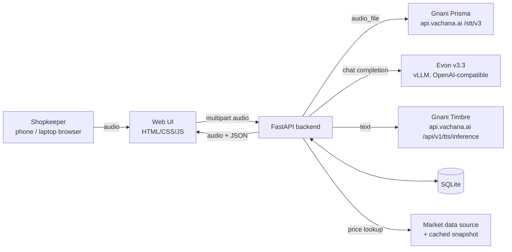
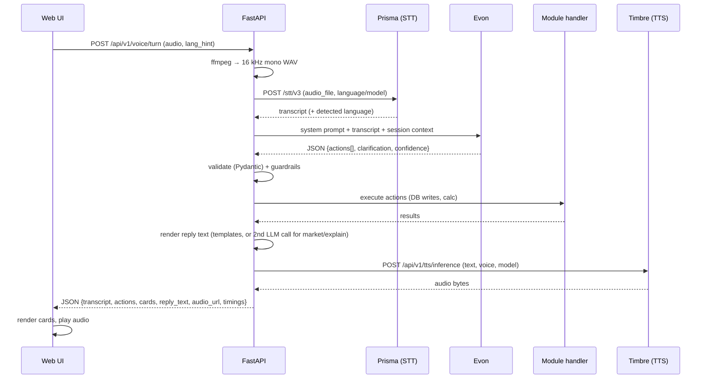

# Munimji — Architecture

## 1. System context



## 2. Components

| Component | Responsibility | Tech |
|---|---|---|
| **Web UI** | Record audio, show transcript and cards, play audio, language toggle | Vanilla JS, MediaRecorder, Web Audio |
| **API layer** | HTTP endpoints, validation, error mapping | FastAPI, Pydantic v2 |
| **Pipeline orchestrator** | Runs one "voice turn" end to end, records timings | `core/pipeline.py` |
| **Audio utilities** | Convert browser audio (webm/opus) to 16 kHz mono WAV, trim, measure | `ffmpeg` via subprocess |
| **Gnani client: STT** | Calls Prisma REST, handles retries and errors | `httpx` (or `gnani-vachana` SDK) |
| **Gnani client: TTS** | Calls Timbre REST, returns audio bytes | `httpx` |
| **Evon adapter** | Calls the Evon server, enforces JSON contract, retries once | OpenAI-compatible HTTP client |
| **Router / intent layer** | Maps validated actions to module handlers | `core/router.py` |
| **Guardrails** | Medical and financial advice blocks, amount limits, confirmation rules | `core/guardrails.py` |
| **Session store** | Last customer, last entry, language, last N turns | In-memory dict with TTL |
| **Module: Khata** | Ledger logic, balances, summaries, undo | `modules/khata` |
| **Module: Parchi** | Prescription parsing to schedule, reminders | `modules/parchi` |
| **Module: Bazaar** | Market snapshot, caching, summarisation | `modules/bazaar` |
| **i18n / templates** | Reply templates per language, number and currency phrasing | `core/i18n.py` |
| **Persistence** | SQLite schema and queries | `db/` |

## 3. Voice turn data flow



### Latency budget (target ≤ 4 s)

| Stage | Budget |
|---|---|
| Upload + ffmpeg | 0.2 s |
| Prisma STT | 0.5–1.2 s |
| Evon (single call, ≤ 300 output tokens) | 1.0–2.0 s |
| Python logic + DB | < 0.05 s |
| Timbre TTS (short sentence) | 0.5–1.0 s |
| **Total** | **≈ 2.5–4.5 s** |

Levers if over budget: shorter replies, SSE TTS streaming, parallel TTS of the first sentence, smaller context for Evon, quantised Evon on a faster GPU.

## 4. Model usage

| Stage | Model | Mode | Notes |
|---|---|---|---|
| STT | Prisma v3.0 | REST, `POST /stt/v3` | Auto language detection for code-mixed speech. Fall back to v2.5 with an explicit `language_code` if v3.0 misbehaves |
| Understanding | Evon v3.3 30B-A3B | OpenAI-compatible chat via vLLM | Temperature ≈ 0–0.2, reasoning/thinking output disabled or stripped |
| Reply speech | Timbre v2.5 | REST first, SSE as stretch | Pick a Hindi voice for hi/Hinglish; verify a Marathi voice in the voice catalogue |

### Evon serving options (decide in the first hour)

| Option | Hardware | Pros | Cons |
|---|---|---|---|
| A. Hosted access provided by the hackathon | None | Zero setup | Check availability on the challenge dashboard or Discord |
| B. vLLM, BF16, rented GPU | ~80 GB GPU | Best fidelity | Cost, cold start, weight download |
| C. Quantised build on smaller GPU | ~24 GB GPU | Cheaper | Possible accuracy drop; verify support for the `nemotron_h` architecture |
| D. Deterministic rules parser (safety net) | CPU | Never fails, instant | Narrow coverage, not "Evon" |

The adapter reads `EVON_BASE_URL`. If the Evon health check fails at startup or mid-demo, the router can fall back to option D and **the UI shows a small "offline parser" badge**. Never hide the fallback.

## 5. Evon contract (summary)

Evon must return exactly one JSON object:

```json
{
  "language": "hinglish",
  "actions": [
    {"tool": "add_credit", "args": {"customer_name": "रमेश", "customer_name_roman": "Ramesh", "amount": 200}},
    {"tool": "record_payment", "args": {"customer_name": "सुनीता", "customer_name_roman": "Sunita", "amount": 150}}
  ],
  "clarification": null,
  "confidence": 0.93
}
```

Full schemas, prompt and examples in `evon-prompts.md`.

Validation pipeline: parse JSON → Pydantic discriminated union per tool → guardrail checks → fuzzy customer match → execute. One automatic retry (with the validation error appended); then clarification question or rules parser.

## 6. Module boundaries

```
backend/app/
  main.py              # app factory, static files, CORS
  config.py            # env settings (pydantic-settings)
  api/                 # routers: voice, text, ledger, prescriptions, market, health
  core/
    pipeline.py        # run_turn()
    router.py          # action → handler dispatch
    guardrails.py
    session.py
    i18n.py            # templates, number phrasing
    audio.py           # ffmpeg wrapper
  gnani/
    stt.py  tts.py  evon.py  errors.py
  modules/
    khata/    service.py  tools.py  templates.py
    parchi/   service.py  tools.py  templates.py
    bazaar/   service.py  tools.py  templates.py  sources.py
  db/
    models.py  session.py  schema.sql  seed.py
  tests/
frontend/
  index.html  app.js  styles/tokens.css  styles/app.css  assets/
scripts/
  run_dev.sh  seed_demo.py  eval_utterances.py
data/
  munimji.db  demo_snapshot.json
```

Each module exposes a **tool registry**: name, Pydantic arg model, handler, reply template keys. Adding a tool = one entry. The Evon system prompt is generated from the registry so prompt and code cannot drift.

## 7. Key design rules

1. **Money is integer paise.** No floats. Display helpers convert.
2. **Writes are append-only.** Corrections create a void flag plus a new entry; nothing is deleted.
3. **Every utterance is logged** (transcript, parsed JSON, status, timings) for debugging and the demo.
4. **The LLM never writes to the DB directly** and never computes balances.
5. **Reply text comes from templates** whenever the result is structured. The LLM writes prose only for market summaries and prescription explanations, constrained by facts passed in.
6. **Idempotency:** each turn has a `turn_id`; replaying the same `turn_id` returns the stored result and does not re-apply writes.
7. **Timeouts everywhere:** STT 10 s, Evon 15 s, TTS 10 s. On TTS failure, return text-only reply with a "voice unavailable" flag so the UI still works.

## 8. Error handling matrix

| Failure | Detection | Behaviour |
|---|---|---|
| Silence / too short audio | Duration < 0.4 s or empty transcript | Ask "Dobara boliye" (prompted in selected language), no LLM call |
| STT 401 | HTTP 401 | Surface config error in the dev panel; UI says "service key problem" |
| STT 5xx / timeout | Exception | One retry, then text-input fallback |
| Evon timeout / invalid JSON | Timeout, parse or validation error | One retry with error hint, then rules parser, then clarification |
| Low confidence (< 0.6) or unknown customer with large amount | Guardrail | Ask a short confirmation question |
| TTS failure | Exception | Return reply text; UI shows text; badge "voice unavailable" |
| Market source down | Exception | Use cached or sample snapshot, clearly labelled with timestamp |
| DB locked | SQLite error | Retry with short backoff; WAL mode on |

## 9. Architecture decision records

**ADR-1 — JSON contract instead of native tool-calling parser.**
Evon advertises tool-calling, but server-side tool parsers depend on the serving stack and model template. A plain JSON contract validated by Pydantic works on any server and is easier to test. Native tool-calling can be enabled later behind the same adapter.

**ADR-2 — REST STT, not WebSocket.**
Shop commands are short (2–10 s). REST is simpler to build and debug. Realtime streaming is documented as a stretch and not needed for the demo.

**ADR-3 — Templates for replies.**
A second LLM call adds 1–2 s and invites hallucinated numbers. Structured results are phrased by templates in each language; only free-form summaries use the LLM.

**ADR-4 — SQLite, single device.**
Hackathon scope. A schema with `source_utterance_id` on every entry keeps a clean path to multi-device sync later.

**ADR-5 — Vanilla frontend.**
No build step, no framework tax, deploys as static files from FastAPI. Fewer moving parts for a solo three-day build.

**ADR-6 — Browser audio converted server-side.**
Browsers produce webm/opus. Prisma documents WAV, MP3, OGG, FLAC, AAC and M4A, so convert with ffmpeg to 16 kHz mono WAV rather than trust format support.

## 10. Scalability and future path (not for the hackathon, but credible)

- Swap SQLite for Postgres; add `shop_id` and auth.
- Move STT to Realtime WebSocket for live conversation.
- Move TTS to Realtime for sub-second voice.
- Offline queue in the PWA when connectivity drops.
- Per-shop cloned voice (Timbre voice cloning with explicit consent) for customer-facing reminders.
