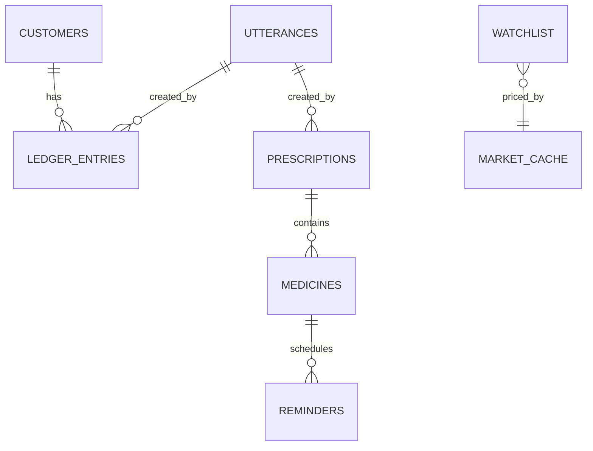

# Munimji — Data Model

SQLite, WAL mode, single file `data/munimji.db`. Timestamps stored in **UTC ISO-8601**; converted to IST (`Asia/Kolkata`) for display and for reminder maths.

## 1. Entity overview



## 2. Schema

```sql
PRAGMA journal_mode = WAL;
PRAGMA foreign_keys = ON;

CREATE TABLE schema_version (version INTEGER NOT NULL);
INSERT INTO schema_version VALUES (1);

-- Every voice or text turn, kept for debugging, idempotency and the demo
CREATE TABLE utterances (
  id                TEXT PRIMARY KEY,          -- turn_id (UUID)
  session_id        TEXT NOT NULL,
  transcript        TEXT,
  detected_language TEXT,                      -- hi | mr | en | hinglish
  parser            TEXT,                      -- evon | rules
  llm_json          TEXT,                      -- validated JSON from Evon
  status            TEXT NOT NULL,             -- ok | clarify | error
  error_code        TEXT,
  reply_text        TEXT,
  timings_json      TEXT,
  created_at        TEXT NOT NULL DEFAULT (datetime('now'))
);

CREATE TABLE customers (
  id          INTEGER PRIMARY KEY,
  name        TEXT NOT NULL,                   -- as spoken / transcribed (may be Devanagari)
  name_roman  TEXT NOT NULL,                   -- Latin form from Evon, e.g. "Ramesh"
  name_key    TEXT NOT NULL,                   -- normalised key for fuzzy match
  phone       TEXT,
  created_at  TEXT NOT NULL DEFAULT (datetime('now'))
);
CREATE INDEX idx_customers_key ON customers(name_key);

CREATE TABLE ledger_entries (
  id                 INTEGER PRIMARY KEY,
  customer_id        INTEGER NOT NULL REFERENCES customers(id),
  kind               TEXT NOT NULL CHECK (kind IN ('CREDIT','PAYMENT')),
  amount_paise       INTEGER NOT NULL CHECK (amount_paise > 0),
  note               TEXT,
  utterance_id       TEXT REFERENCES utterances(id),
  corrects_entry_id  INTEGER REFERENCES ledger_entries(id),
  created_at         TEXT NOT NULL DEFAULT (datetime('now')),
  voided_at          TEXT,
  voided_by          TEXT                        -- utterance id or 'ui'
);
CREATE INDEX idx_entries_customer ON ledger_entries(customer_id, created_at);

-- Balance = credit given − payments received, ignoring voided entries
CREATE VIEW customer_balances AS
SELECT c.id AS customer_id, c.name, c.name_roman,
       COALESCE(SUM(CASE WHEN e.kind='CREDIT'  AND e.voided_at IS NULL THEN e.amount_paise END),0)
     - COALESCE(SUM(CASE WHEN e.kind='PAYMENT' AND e.voided_at IS NULL THEN e.amount_paise END),0)
       AS balance_paise
FROM customers c LEFT JOIN ledger_entries e ON e.customer_id = c.id
GROUP BY c.id;

CREATE TABLE prescriptions (
  id            INTEGER PRIMARY KEY,
  patient_label TEXT NOT NULL,                  -- "Maa", "Papa", "Aarav"
  doctor_note   TEXT,
  start_date    TEXT NOT NULL,                  -- local date, YYYY-MM-DD
  duration_days INTEGER,
  status        TEXT NOT NULL DEFAULT 'active', -- active | cancelled | completed
  utterance_id  TEXT REFERENCES utterances(id),
  created_at    TEXT NOT NULL DEFAULT (datetime('now'))
);

CREATE TABLE medicines (
  id              INTEGER PRIMARY KEY,
  prescription_id INTEGER NOT NULL REFERENCES prescriptions(id) ON DELETE CASCADE,
  name            TEXT NOT NULL,                -- as the user said it
  dose_text       TEXT,                         -- verbatim; never interpreted or altered
  with_food       TEXT CHECK (with_food IN ('before','after','with') OR with_food IS NULL),
  times_json      TEXT NOT NULL                 -- ["morning","evening"]
);

CREATE TABLE reminders (
  id             INTEGER PRIMARY KEY,
  medicine_id    INTEGER NOT NULL REFERENCES medicines(id) ON DELETE CASCADE,
  due_at         TEXT NOT NULL,                 -- UTC
  status         TEXT NOT NULL DEFAULT 'pending', -- pending | done | snoozed | missed
  snoozed_until  TEXT,
  done_at        TEXT
);
CREATE INDEX idx_reminders_due ON reminders(status, due_at);

CREATE TABLE watchlist (
  id       INTEGER PRIMARY KEY,
  symbol   TEXT NOT NULL UNIQUE,                -- e.g. ^BSESN, RELIANCE.NS (source dependent)
  label    TEXT NOT NULL,                       -- "Sensex", "Reliance"
  position INTEGER NOT NULL
);

CREATE TABLE market_cache (
  symbol      TEXT PRIMARY KEY,
  price       REAL NOT NULL,
  change_abs  REAL,
  change_pct  REAL,
  as_of       TEXT NOT NULL,                    -- UTC
  source      TEXT NOT NULL,                    -- live name | cache | sample
  is_sample   INTEGER NOT NULL DEFAULT 0
);

CREATE TABLE pending_confirmations (
  id           TEXT PRIMARY KEY,
  session_id   TEXT NOT NULL,
  payload_json TEXT NOT NULL,                   -- the actions awaiting "haan/nahi"
  expires_at   TEXT NOT NULL
);

CREATE TABLE settings (key TEXT PRIMARY KEY, value TEXT NOT NULL);
```

## 3. Rules

| Rule | Detail |
|---|---|
| Money | Integer paise. ₹850 → `85000`. Round-trip helpers: `to_paise(rupees)`, `format_rupees(paise)` |
| Immutability | Entries are never deleted. Undo sets `voided_at`; correction voids and inserts a new row with `corrects_entry_id` |
| Idempotency | `utterances.id` is the `turn_id`. If it exists, return the stored reply and do not re-run actions |
| Sessions | Last customer, last entry ids and language live in memory (TTL 2 h), not in the DB |
| Prescriptions | Medicine names and doses are stored **verbatim**. No normalisation of doses, no interactions logic |
| Retention | Audio files are deleted after processing (or 30 min in debug). Transcripts and entries stay locally until the user clears them |

## 4. Name matching

Goal: "रमेश", "Ramesh", "Rameshh", "Ramesh ji" should map to one customer.

1. Evon returns `customer_name` (as heard) and `customer_name_roman`.
2. Normalise `name_key`: lowercase → strip honorifics (`ji`, `bhai`, `kaka`, `mama`, `sir`, `madam`) → collapse repeated letters → map `w→v`, `ph→f`, `sh→s`, `ee→i`, `oo→u` → remove spaces.
3. Match order: exact `name_key` → `rapidfuzz.fuzz.ratio ≥ 88` single hit → if two hits within 5 points, **ask which one** → else **create a new customer** and say so.
4. Optional hardening: also compare the Devanagari form using `indic-transliteration` if Evon's roman form is missing.

## 5. Seed data for the demo (`scripts/seed_demo.py`)

| Customer | Opening balance |
|---|---|
| Ramesh | ₹650 |
| Sunita | ₹150 |
| Patil | ₹1,200 |
| Ganesh | ₹400 |
| Shinde | ₹300 |

Watchlist: Sensex, Nifty 50, Reliance, TCS, HDFC Bank. Settings: language `auto`, voice per language.

With this seed, "Ramesh ko 200 udhaar" yields ₹850 and "Sunita ne 150 diye" clears Sunita — matching the demo script. Seed entries are tagged `utterance_id = 'seed'`.

## 6. Migrations

For the hackathon: `schema.sql` plus `schema_version`. If the schema must change after data exists, add `migrations/002_*.sql` and bump the version; no ORM migration tool needed.

## 7. Backups

`cp data/munimji.db data/backup-$(date +%F-%H%M).db` before each demo recording. The demo database is rebuilt from `seed_demo.py` for a clean take.
